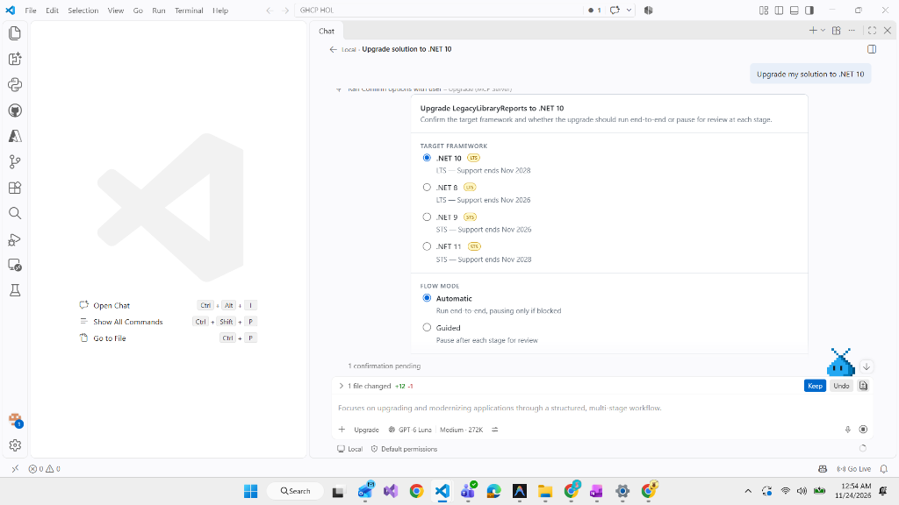
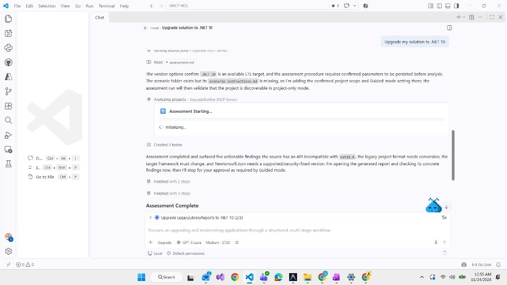
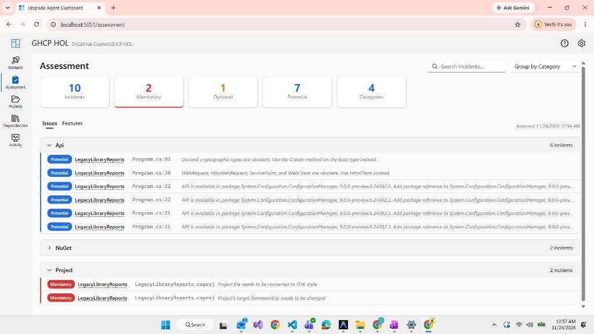
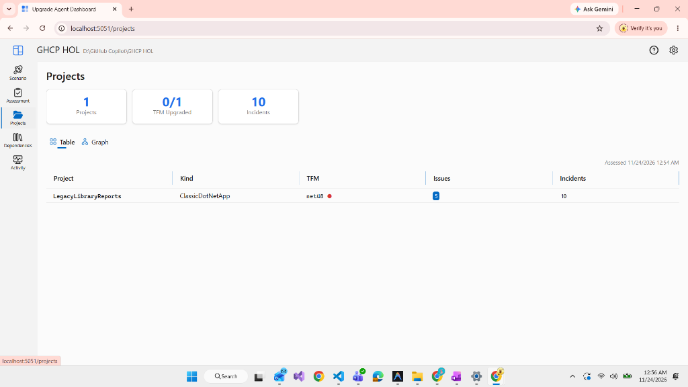

# Exercise 8: .NET Application Modernization with GitHub Copilot

[⬅️ Previous: Exercise 7](07-copilot-agents.md) | [Table of Contents](README.md)

---

## 🎯 Objective
Learn how to modernize a legacy **.NET Framework 4.8** console application (`legacy-dotnet-app/`) to modern cross-platform **.NET 10** using the **GitHub Copilot Upgrade** extension and its specialized **Upgrade Agent** (`Upgrade`), guiding you through **Assessment → Planning → Execution**.

---

## ✅ Prerequisites
- **.NET SDK 10.0 or later** (`dotnet --version`)
- Visual Studio Code with **GitHub Copilot Chat**
- **GitHub Copilot Upgrade** extension installed from VS Code Marketplace (search for `GitHub Copilot Upgrade`)

---

## 📂 Target Project
- Project Folder: `legacy-dotnet-app/`
- Legacy Project File: `legacy-dotnet-app/LegacyLibraryReports.csproj` (.NET Framework 4.8)
- Source Code: `legacy-dotnet-app/Program.cs`
- Configuration: `legacy-dotnet-app/App.config` & `packages.config`

---

## 🔍 Legacy Patterns in the Project
The application contains several patterns typical of older .NET Framework code:
1. **Target Framework:** Legacy `.NET Framework 4.8` with old verbose `.csproj` schema.
2. **Synchronous Networking:** Deprecated `System.Net.WebClient` (`DownloadString`).
3. **Deprecated Cryptography:** `MD5CryptoServiceProvider` (obsolete in modern .NET).
4. **Legacy ASP.NET Utility:** `System.Web.HttpUtility.UrlEncode` in a console app.
5. **Old Config Provider:** `System.Configuration.ConfigurationManager` and `App.config`.
6. **Outdated Package:** Newtonsoft.Json 9.0.1 (can be upgraded or modernized with `System.Text.Json`).
7. **Blocking Console/File I/O:** `Console.ReadKey()` and synchronous `File.WriteAllText`.

---

## 📝 Step-by-Step Instructions

### Step 1: Install the GitHub Copilot Upgrade Extension
1. Open the Extensions view in VS Code (<kbd>Ctrl</kbd> + <kbd>Shift</kbd> + <kbd>X</kbd> or <kbd>Cmd</kbd> + <kbd>Shift</kbd> + <kbd>X</kbd>).
2. Search for:
   ```text
   GitHub Copilot Upgrade
   ```
3. Click **Install**.
4. Once installed, the extension registers the dedicated **Upgrade** agent inside GitHub Copilot Chat.

Verify your installed .NET SDK version in the terminal:
```bash
dotnet --version
```

---

### Step 2: Select the **Upgrade Agent** in Copilot Chat

1. Open Copilot Chat (<kbd>Ctrl</kbd> + <kbd>Alt</kbd> + <kbd>I</kbd> or <kbd>Cmd</kbd> + <kbd>Shift</kbd> + <kbd>I</kbd>).

2. Look at the bottom-left of the chat input box at the agent selector button (where it shows `+ Agent` or `Set Agent (Ctrl+.)`).

3. Click the agent selector and choose **Upgrade** from the agent list.
   - The badge in the prompt input will now display **`Upgrade`**.

---

### Step 3: Provide the Prompt to Plan the Upgrade
In the chat prompt input with the **Upgrade** agent active, enter the following prompt:

```text
Upgrade my .NET solution from 4.8 to .NET 10
```

---

### Step 4: Confirm Options & Review the Assessment Dashboard

> ℹ️ **Note for Attendees:**  
> The screenshots below are provided for your **visual reference and information** so you know what each interactive step and dashboard view looks like as Copilot performs the upgrade.

#### 1. Confirm Framework & Flow Mode
The Upgrade Agent will prompt you with interactive configuration options directly in Copilot Chat:
- **TARGET FRAMEWORK:** Select **`.NET 10 (LTS)`**
- **FLOW MODE:** Choose **`Automatic`** (runs end-to-end, pausing only if blocked) or **`Guided`** (pauses after each stage for review)



#### 2. Assessment Execution
Once confirmed, the Upgrade Agent initializes its MCP server tools and analyzes your project structure (`LegacyLibraryReports.csproj`, `Program.cs`, `App.config`, `packages.config`):



#### 3. Automatic Web Assessment Dashboard
The extension automatically spins up an interactive web assessment dashboard at `http://localhost:5051/assessment`. Open the dashboard in your browser to inspect categorized findings:
- **Mandatory (2):** Project file conversion to SDK style and changing the target framework to `net10.0`.
- **Potential (7):** Obsolete API usages such as `WebClient`, `MD5CryptoServiceProvider`, `System.Web.HttpUtility`, and `System.Configuration.ConfigurationManager`.
- **NuGet (2):** Outdated `Newtonsoft.Json 9.0.1` package reference.



#### 4. Project-Level Modernization View
You can also navigate to the **Projects** tab in the dashboard (`http://localhost:5051/projects`) to view the high-level inventory of projects, Target Framework Moniker (TFM: `net48`), kind (`ClassicDotNetApp`), and overall modernization progress (0/1 TFM Upgraded, 10 incidents):



---

### Step 5: Approve & Execute the Upgrade

Review each step proposed by the Upgrade Agent and click **Proceed** / **Apply** (or enter confirmation in chat) to execute the plan:

1. **`LegacyLibraryReports.csproj`** is converted to modern SDK-style:
   ```xml
   <Project Sdk="Microsoft.NET.Sdk">

     <PropertyGroup>
       <OutputType>Exe</OutputType>
       <TargetFramework>net10.0</TargetFramework>
       <ImplicitUsings>enable</ImplicitUsings>
       <Nullable>enable</Nullable>
     </PropertyGroup>

   </Project>
   ```
2. **`packages.config` & `AssemblyInfo.cs`:** Obsolete files are cleaned up or incorporated into SDK-style properties.

3. **`Program.cs`** is refactored to modern .NET 10 standards:
   - `WebClient.DownloadString()` → `await httpClient.GetStringAsync()`
   - `MD5CryptoServiceProvider` → `MD5.HashData()`
   - `HttpUtility.UrlEncode` → `Uri.EscapeDataString` or `WebUtility.UrlEncode`
   - `Newtonsoft.Json` → native high-performance `System.Text.Json`
   - Non-blocking async file I/O (`File.WriteAllTextAsync`)

---

### Step 6: Build and Run the Modernized Application

Open your terminal, navigate to `legacy-dotnet-app/`, and build and run:

```bash
cd legacy-dotnet-app
dotnet build
dotnet run
```

**Expected Result:**

The application builds cleanly without obsolete warnings, executes asynchronously on the modern .NET runtime, computes MD5 hashes using modern cryptography, and outputs the report successfully!

> 💡 If any build warning or issue arises, simply ask the **Upgrade** agent in Copilot Chat:

> ```text
> Fix build errors and modernize remaining synchronous file writing in Program.cs
> ```

---

## 💡 Key Takeaways
- **Dedicated Upgrade Agent:** The **GitHub Copilot Upgrade** extension provides a specialized `Upgrade` agent in the Copilot Chat agent selector for structured migrations.
- **Intent-Driven Planning:** Prompting `"Upgrade my .NET solution from 4.8 to .NET 10"` creates an end-to-end plan before code changes are applied.
- **SDK-style Projects:** Modern .NET eliminates hundreds of lines of legacy XML project boilerplate with clean `<Project Sdk="Microsoft.NET.Sdk">`.
- **Modern .NET APIs:** Automatic replacement of obsolete synchronous APIs (`WebClient`, `MD5CryptoServiceProvider`) with safe, high-performance async alternatives (`HttpClient`, `MD5.HashData`, `System.Text.Json`).

---

## 🎓 Congratulations!

You have completed all 8 hands-on exercises of the **GitHub Copilot Hands-On Lab Workshop**!

### Summary of What You Mastered:
- ✅ **Setup & Template Clone:** Quickstart with an organization template
- ✅ **Code from Intent & Code Explanation:** Prompt-driven code generation, `@workspace` in Ask mode, and `/explain`
- ✅ **Diagnosing & Fixing (`/fix`):** Resolving race conditions & inventory leaks with pytest verification
- ✅ **Generating Unit Tests (Agent Mode):** Automated test file creation with parametrized tests
- ✅ **Path-Specific Instructions:** Scoping documentation standards via `applyTo: "docs/**/*.md"`
- ✅ **Custom Agents & Skills:** Authoring dedicated skills in `.github/skills/` and agent personas in `.github/agents/`
- ✅ **Model Context Protocol (MCP):** Creating GitHub issues directly from chat via GitHub MCP
- ✅ **Agent Harnesses:** Comparing Local, Copilot SDK (Fusion), and Cloud agents
- ✅ **App Modernization:** Using the **Upgrade Agent** to modernize legacy .NET Framework 4.8 apps to .NET 10

---

[⬅️ Previous: Exercise 7](07-copilot-agents.md) | [Table of Contents](README.md)
